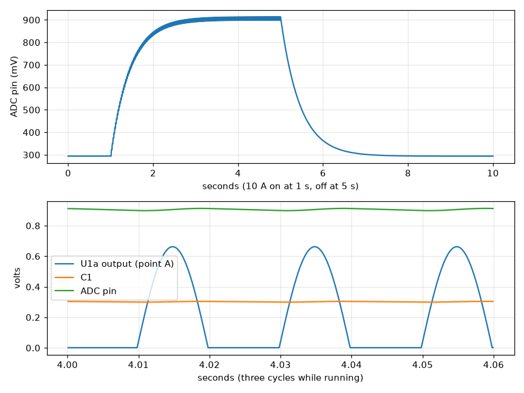
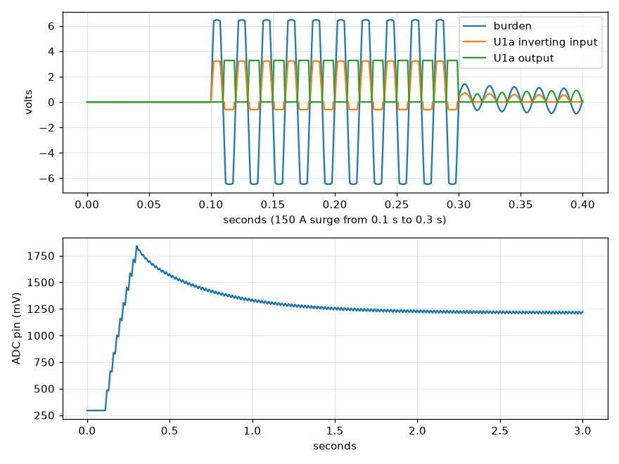
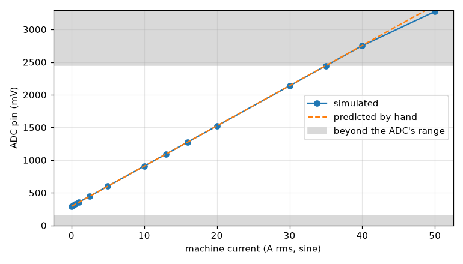

# Current sensor

The circuit between the current transformer on the machine's supply and the ESP32's analogue input. It gives
the ESP32 a steady voltage that rises with the machine's current, which the reader compares with the
machine's threshold from BBMS to count motor-on seconds.

**Status: simulated only.** The circuit has not been built, and the simulation is a purpose-written one that
has not been cross-checked against SPICE (see [What the simulation doesn't cover](#what-the-simulation-doesnt-cover)).

## Circuit

```
            R1 22k            R2 22k
CT ──┬──┬───/\/\/──┬──────────/\/\/─────┐
     │  │          │   ┌──────────┐     │
    Rb  TVS        └───┤−   U1a   ├─────┴── A
    47R │          ┌───┤+         │
     │  │          │   └──────────┘
GND ─┴──┴──────────┘

                 3V3
                  │
                 R4 3M3
       R3 100k    │    ┌──────────┐          R7 1k
A ─────/\/\/──────┼────┤+   U1b   ├──┬───────/\/\/──┬── ADC pin (GPIO34)
                  │  ┌─┤−         │  │              │
              C1 4µ7 │ └──────────┘  │           C2 100n
                  │  ├────/\/\/──────┘              │
                 GND │   R5 20k                    GND
                    R6 10k
                     │
                    GND
```

| Part | Value | Notes |
|---|---|---|
| CT | 1000:1 current transformer | on one conductor of the machine's supply |
| Rb | 47 Ω, 1% | the burden. On the board, right at the CT connector, so the secondary can never be open-circuit |
| TVS | bidirectional, 5 V (SMAJ5.0CA or similar) | only conducts in a large surge or if Rb fails. Not signal diodes: they would conduct in normal use |
| R1, R2 | 22 kΩ, 1% | |
| R3 | 100 kΩ, 1% | |
| R4 | 3.3 MΩ, 1% | |
| R5 | 20 kΩ, 1% | |
| R6 | 10 kΩ, 1% | |
| R7 | 1 kΩ | |
| C1 | 4.7 µF, X7R ceramic | not an electrolytic: its leakage through 100 kΩ would shift the zero |
| C2 | 100 nF | at the ESP32's pin |
| U1 | dual rail-to-rail CMOS op-amp, powered from the ESP32's 3.3 V | TLV9002 or TLV9062 preferred; see [Choosing the op-amp](#choosing-the-op-amp). 100 nF across its supply pins |

## How it works

1. **Burden (Rb).** Turns the transformer's current into a voltage: 66 mV peak for each amp the machine draws.
2. **Rectifier (U1a).** An inverting amplifier with a gain of 1 and no negative supply. Negative half-cycles
   come out positive; on positive half-cycles the output sits at 0 V because it can go no lower. There is no
   diode, so no diode drop.
3. **Average and offset (R3, C1, R4).** A 0.46 s time constant smooths the half-cycles to their average. R4
   lifts the resting level so that zero current reads about 0.29 V at the pin, clear of the bottom 0.15 V
   that the ESP32's ADC cannot read.
4. **Gain and buffer (U1b).** Multiplies the smoothed voltage by 3. Amplifying after smoothing, not before,
   leaves room for the peaks in U1a. R7 and C2 give the ADC a steady source.

Why it is this way:

- **Half-wave is enough.** A transformer cannot pass DC, so the two halves of its output always have the same
  area. Averaging one half gives exactly half the full-wave answer whatever the waveform, so a full-wave
  rectifier would add an op-amp for nothing.
- **Average, not peak.** A peak detector latches on to spikes and motor-brush noise.
- **A large burden and a gain of only 1 in U1a.** U1a's offset voltage is what limits accuracy at small
  currents. The larger the signal at its input, the less the offset matters. (An earlier version with 22 Ω
  and a gain of 2.2 lost up to 0.4 A to it.)
- **Overloads are harmless.** A starting surge just clips. The ADC pin cannot go above 3.3 V, because that is
  the op-amp's supply.

## What the ESP32 sees

About **294 mV with the machine off, rising by 61.6 mV for each amp** (sine wave, rms).

| Machine current | ADC pin |
|---|---|
| 0 A | 0.29 V |
| 2.5 A | 0.45 V |
| 13 A | 1.09 V |
| 30 A | 2.14 V |
| about 35 A | the top of the ADC's range |

To change the range, change Rb: the millivolts per amp are in proportion to it. Check first that the
transformer can drive it. With 47 Ω, 30 A puts 2 V peak across the burden.

## Simulation results

`uv run current_sensor/simulate.py` prints these and redraws the graphs. It takes about two minutes. The part
values are at the top of the script, in `Parts`.

**Accuracy.** With ideal op-amps the readings are within 1% of the hand calculation from 2.5 A upwards. Over
200 simulated boards (1% resistors, a 3.3 V rail within 3%, the transformer's ratio within 1%, op-amp
offsets spread over their data-sheet limits):

| Op-amp (offset limit) | A true 1 A reads | A true 2.5 A reads | A true 13 A reads |
|---|---|---|---|
| TLV9002 (±1.6 mV) | 0.82 to 1.01 A | 2.30 to 2.54 A | 12.5 to 13.3 A |
| MCP6002 (±4.5 mV) | 0.71 to 1.02 A | 2.18 to 2.55 A | 12.4 to 13.3 A |

The zero reading was between 278 and 333 mV on every board.

**Speed.** A reading reaches 90% of its final value in 1.0 s. A 10 A machine crosses a 2.5 A threshold 0.13 s
after it is switched on and 0.63 s after it is switched off. Five seconds after switch-off the pin is within
0.01 mV of zero.

**Ripple.** 15 mV peak to peak at 10 A, so a reading wanders by about ±0.12 A. It is in proportion to the
current.



**Starting surge** (150 A for 0.2 s, then 15 A). The TVS holds the burden to 6.4 V. The op-amp's input
protection diodes carry 0.09 mA at most, where op-amps allow 2 mA or more. The reading then settles to the
right value for 15 A.



**Burden resistor open-circuit** (15 A flowing). The TVS holds the transformer to 6.4 V, and the protection
diodes again carry 0.09 mA at most.

**Currents that aren't sine waves.** The circuit measures the average of the rectified current, and the
firmware scales that as if it were a sine wave. Other shapes read lower than their true rms: a 10 A sine
chopped at 90° (7.07 A rms) reads 5.1 A. That is fine for a threshold. A load that draws current in one
direction only reads the same whichever way round it is (5.46 A and 5.47 A), which is the check that
half-wave rectification is enough.



## Choosing the op-amp

It needs inputs that work at ground and an output that reaches within a few millivolts of ground, on a 3.3 V
supply. Speed doesn't matter. Offset voltage does: it takes a roughly fixed amount off every reading,
whichever its sign.

| U1a's offset | A true 2.5 A reads |
|---|---|
| 0 | 2.47 A |
| ±1.6 mV (TLV9002 or TLV9062 at its limit) | 2.40 to 2.44 A |
| ±4.5 mV (MCP6002 at its limit) | 2.26 to 2.31 A |
| ±7 mV (LMV358 at its limit) | 2.15 to 2.19 A |

A TLV9002 or TLV9062 is the one to fit. An MCP6002 works. An LMV358 is best avoided.

The error is the same every time on a given board, and an admin chooses a machine's threshold in BBMS while
watching this reader's own live reading, so it shifts the numbers more than it affects the result.

## What the simulation doesn't cover

- **It is not SPICE.** No SPICE engine can be installed from PyPI, so `simulate.py` writes the circuit's
  equations out and steps them through time. It agrees with the hand calculation, and a step five times
  shorter gives the same answer, but nothing independent has checked it. The circuit is small enough to
  enter into LTspice in a few minutes for a second opinion.
- **The transformer is a guess.** Its winding resistance (50 Ω) and magnetising inductance (5 H) are typical
  figures, not those of the part to be fitted. Its core never saturates in the simulation, which makes the
  surge result pessimistic.
- **No noise, and no ADC errors.** The ESP32's ADC is noisy and not very linear. The firmware averages eight
  readings.
- **Op-amp outputs near ground.** The simulation assumes the outputs reach within 1 mV of ground (0.5 to 5 mV
  across the simulated boards). U1a only sinks a few microamps there, so that is reasonable for a CMOS
  output, but it is an assumption. Each extra millivolt takes about 0.02 A off every reading.

## Firmware

In `data/config.json` (defaults in `app/config.py`):

| Setting | Default | |
|---|---|---|
| `current_mv_per_amp` | 61.6 | the rise at the pin for each amp |
| `current_zero_mv` | 290 | what the pin reads with the machine off; only a starting point |
| `current_zero_tolerance_mv` | 150 | see below |

The reader measures the zero itself: whenever the relay has been off for five seconds, the machine can be
drawing nothing, so what the pin reads then is zero. A reading further than `current_zero_tolerance_mv` from
`current_zero_mv` is not used and is logged instead, so that a relay welded shut, or a sensor fault, isn't
quietly taken for zero.

For a different sensor circuit, set `current_mv_per_amp` and `current_zero_mv` to suit it.
